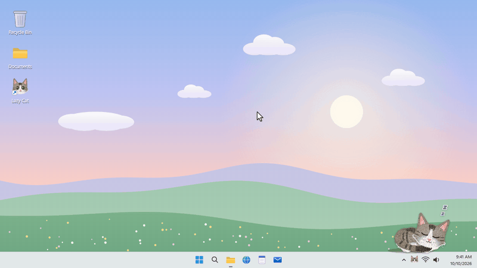

# Lazy Cat Companion 🐈

> A tiny desktop cat for Windows. It naps in the corner of your screen, wakes up when you double-click it, purrs when you pet it, and leaps to any spot on the wallpaper you click. The cat is drawn entirely in code (no sprites or images), so every movement blends smoothly into the next.

[](https://github.com/raisulsohan/LazyCatCompanion/releases)
[](https://github.com/raisulsohan/LazyCatCompanion)
[](https://dotnet.microsoft.com/download/dotnet/10.0)
[](https://github.com/raisulsohan/LazyCatCompanion)
[](https://github.com/raisulsohan)
[](LICENSE)

<p align="center">
  
</p>

<p align="center">
  <em>🐾 Wake it, pet it, call it, carry it. 15 seconds with the real cat, rendered by the app itself.</em><br>
  <a href="demo/lazycat-demo.html">🎮 <b>Open the Interactive 15s Demo Player with Sound</b></a> · <a href="demo/lazycat-demo.mp4">MP4</a>
</p>

---

## ✨ Features

- **A cat that lives on your desktop**: it sleeps in the bottom-right corner with little *z*'s floating up, breathing slowly, ears twitching now and then.
- **Double-click to wake it**: it lifts its head, stretches with a big yawn, then sits with its tail curled round its paws. Double-click again and it lies down and dozes off.
- **Click the wallpaper to call it**: it turns to face the spot, wiggles its rear, and leaps there in an arc.
- **Pet it**: rest the pointer on the cat and it closes its eyes happily while hearts float up.
- **Carry it by the scruff**: drag the cat anywhere; it dangles and swings as you move, and sits down where you let go.
- **It watches you**: move the pointer near it and it follows with its eyes, pupils wide and tail twitching.
- **11 ways of sitting**: upright, alert, hunched, loaf, sphinx, lounging like a person, slouched, meerkat, paw raised, licking a paw, and leg-up grooming. Left alone, it changes pose or yawns every so often, lies down after a minute and falls asleep after 90 seconds.
- **Modeled on a real cat**: a brown tabby-and-white with a white blaze, bib, belly and legs, green eyes, big ears with white tufts, a dark-tipped tail and a black collar. Or pick one of 10 plain coats, or any custom color.
- **Light on your PC**: it redraws at 60 fps only while leaping or being carried, 30 fps otherwise and 15 fps asleep. Transparent pixels pass clicks through to whatever is underneath.
- **No admin rights needed**: installs into your user profile, with an uninstaller.

---

## 🚀 Download

Download **`LazyCatCompanion-Setup.exe`** from the [**Latest Release**](https://github.com/raisulsohan/LazyCatCompanion/releases/latest):

1. Run `LazyCatCompanion-Setup.exe` (about 67 MB; .NET is bundled, so nothing else to install).
2. Optionally tick *Create a desktop shortcut* and *Start Lazy Cat Companion when Windows starts*.
3. The cat appears asleep in the bottom-right corner, and its face shows up in the system tray.
4. **Uninstall anytime** from Windows **Settings > Apps > Installed apps**.

> The installer isn't code-signed, so Windows SmartScreen may warn on first run: choose **More info → Run anyway**.

---

## 🖱️ Usage

| Do this | And the cat… |
|---|---|
| **Double-click the cat** | wakes up (lifts its head, stretches, yawns, sits), or goes back to sleep |
| **Click the desktop wallpaper** while it is awake | turns, wiggles and leaps to that spot |
| **Rest the pointer on it** | gets petted: happy closed eyes and floating hearts |
| **Drag it** | is carried by the scruff; let go to drop it |
| **Move the pointer near it** | watches the pointer with wide pupils and a twitching tail |
| **Right-click it** (or the tray icon) | opens the menu below |

Clicks inside other windows are ignored, so the cat doesn't chase you while you work, unless you turn on *Jump to clicks on any window*.

### Tray menu

| Item | What it does |
|---|---|
| **Wake up** / **Let the cat sleep** | Same as double-clicking the cat |
| **Sit like…** | Pick one of the 11 ways of sitting (it wakes first if needed) |
| **Cat color** | *Tabby & white (the photo cat)*, Ginger, Cream, Gray, Charcoal, Chocolate, White, Lavender, Blue, Pink, Mint, or *Choose a custom color…* |
| **Size** | Small, Medium or Large |
| **Face** | Which way it looks when it opens and after every landing: *Toward the screen (auto)* (from the bottom-right corner it looks left), *Left* or *Right* |
| **Jump to clicks on any window** | Let it leap to clicks inside windows too, not only on the wallpaper |
| **Exit** | Close the app |

The first seven ways of sitting are resting poses the cat stays in; the rest are short gestures, and the two grooming ones are animated. Coat, size, facing, click mode and the cat's last position are saved in `%AppData%\LazyCatCompanion\settings.json`.

---

## 🛠️ Build from Source

### Prerequisites
- Windows 10 or 11 (64-bit)
- [.NET 10 SDK](https://dotnet.microsoft.com/download/dotnet/10.0)
- [Inno Setup 6](https://jrsoftware.org/isdl.php) (only for the installer)

### Run, publish, package
```cmd
run.bat
```
builds a Debug copy and starts the cat.

```powershell
powershell -ExecutionPolicy Bypass -File build.ps1
powershell -ExecutionPolicy Bypass -File build.ps1 -Installer
```
The first publishes a self-contained, compressed single EXE to `artifacts\publish\win-x64` (no .NET install needed to run it); `-Installer` also builds `artifacts\installer\LazyCatCompanion-Setup.exe` with Inno Setup.

### Development aids
- `LazyCatCompanion.exe --render-preview <folder>` renders contact sheets of every pose, way of sitting and coat, a close-up, and a scripted wake, jump, groom and sleep run, as PNG files, without opening the cat window.
- `LazyCatCompanion.exe --render-demo <folder>` renders the README demo: the real cat acting out a 15-second storyboard on a mock desktop, as 30 fps PNG frames plus `cues.json` for the sound.
- `python demo/make-demo.py` runs `--render-demo`, synthesizes the soundtrack and encodes `demo/lazycat-demo.mp4`, `.gif` and the player `.html` (needs numpy and ffmpeg).

---

## 📁 Files

| File | Role |
|---|---|
| `CatPose.cs` | The pose parameters, the key poses and the ways of sitting |
| `CatRenderer.cs` | Draws a pose: coat, fur grain and tufts, body, legs (two-bone IK), tail, head, face, collar, Zzz and hearts |
| `CatController.cs` | Behavior: wake, jump, doze, drag, sitting changes and grooming, plus breathing, blinking, ear twitches and following the pointer |
| `CatView.cs` | The element the cat is drawn on |
| `CatSettings.cs` | Saved settings: coat, size, facing, click mode and position |
| `MainWindow.xaml.cs` | The transparent window, frame pacing, mouse input, the desktop click hook and settings |
| `CompanionTrayIcon.cs` | Tray menu, with an icon drawn from the cat's own face |
| `LowLevelMouseHook.cs` | Hears desktop clicks while the cat is awake |
| `PreviewRenderer.cs` | `--render-preview` contact sheets |
| `DemoRenderer.cs` | `--render-demo` frames for the README demo |
| `App.xaml`, `MainWindow.xaml`, `app.manifest` | WPF app, window and manifest |
| `Assets/LazyCatCompanion.ico` | App icon (the cat's face) |
| `LazyCatCompanion.csproj` | Project file (.NET 10, WPF) |
| `run.bat` | Builds and runs a Debug copy |
| `build.ps1` | Publishes the EXE and, with `-Installer`, builds the installer |
| `installer/LazyCatCompanion.iss` | Inno Setup script |
| `demo/` | The demo GIF, MP4 and interactive player, and `make-demo.py` that builds them |

---

## 👨‍💻 Developer & Credits

- **Developer**: **Raisul Sohan**
- **GitHub**: [@raisulsohan](https://github.com/raisulsohan)
- **Repository**: [https://github.com/raisulsohan/LazyCatCompanion](https://github.com/raisulsohan/LazyCatCompanion)

---

## 📄 License

This project is licensed under the **MIT License**; see the [LICENSE](LICENSE) file for details.
